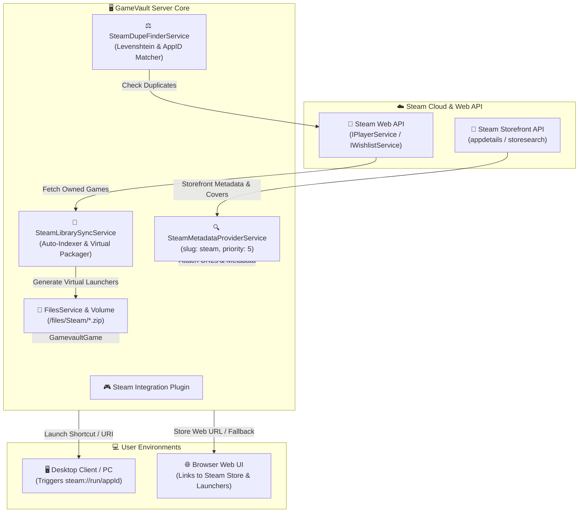

<div align="center">

# 🎮 Universal Steam Integration & Metadata Provider for GameVault

**Native Steam Metadata Scraper, Automated Library Synchronization, Zero-Size Virtual Launchers, Desktop & Browser Redirection, and Duplicate Detection**

[](https://nodejs.org/)
[](https://gamevau.lt/)
[](https://nodejs.org/api/esm.html)
[](https://www.typescriptlang.org/)
[](LICENSE.md)

*Transform your GameVault server into a unified gaming powerhouse. Synchronize your Steam library into GameVault, enrich games with native Steam Storefront metadata, and launch games seamlessly on desktop and web clients.*

</div>

---

## 📖 Table of Contents

1. [Overview & Core Philosophy](#-overview--core-philosophy)
2. [System Architecture](#-system-architecture)
3. [Key Features](#-key-features)
   - [1. Native Steam Metadata Scraper](#1-native-steam-metadata-scraper)
   - [2. Automated Steam Library Synchronization & Virtual Launchers](#2-automated-steam-library-synchronization--virtual-launchers)
   - [3. Environment-Aware Desktop & Web Launching (`steam://run/`)](#3-environment-aware-desktop--web-launching)
   - [4. Steam Library & Wishlist Duplicate Detection](#4-steam-library--wishlist-duplicate-detection)
4. [Installation & Setup](#-installation--setup)
5. [Configuration Reference](#-configuration-reference)
6. [How Virtual Launchers Work](#-how-virtual-launchers-work)
7. [Desktop vs. Browser Launch Behavior](#-desktop-vs-browser-launch-behavior)
8. [Troubleshooting & Diagnostics](#-troubleshooting--diagnostics)
9. [Credits & Attribution](#-credits--attribution)

---

## 🌟 Overview & Core Philosophy

Self-hosted game libraries often suffer from fragmentation: DRM-free standalone games live in GameVault, while purchased titles remain locked inside the Steam client. Managing two separate library views leads to redundant downloads and disconnected playtime tracking.

**`gamevault-steam-plugin`** unites both worlds into a single pane of glass:

1. **Unified Library Representation:** Automatically indexes your owned Steam games inside GameVault as lightweight virtual packages without consuming gigabytes of disk space.
2. **Native Storefront Scraping:** Enriches games with official Steam Storefront metadata (4K covers, screenshots, developer/publisher credits, user tags, and Metacritic scores).
3. **Smart Desktop Redirection:** Clicking "Play" or opening shortcuts triggers your local Steam client (`steam://run/<appId>`) on Windows, macOS, or Linux, with instant web browser store fallbacks.
4. **Duplicate Prevention:** Identifies duplicate games between your vault and Steam library or wishlist to prevent wasted storage.

---

## 🏗 System Architecture



---

## ✨ Key Features

### 1. Native Steam Metadata Scraper
- Acts as a first-class GameVault `MetadataProvider` (slug `steam`).
- Scrapes descriptions, high-resolution header/capsule images, screenshots, developer/publisher credits, categories, tags, and Metacritic ratings.
- Supports ID-based matching (e.g. games with `[steam-620]` or `[steamid-620]` in filename or title).

### 2. Automated Steam Library Synchronization & Virtual Launchers
- Periodically queries your Steam library using `IPlayerService/GetOwnedGames`.
- Automatically generates lightweight (~500 bytes) PKZIP launcher archives inside `/files/Steam/`.
- GameVault's indexer automatically picks them up, turning your entire Steam catalog into browsable library items without duplicating multi-gigabyte installations on your server.

### 3. Environment-Aware Desktop & Web Launching
- Each virtual package and metadata card includes:
  - **Native Desktop URI:** `steam://run/<appId>` to launch or install the game directly in the local Steam client.
  - **Browser Web URL:** `https://store.steampowered.com/app/<appId>` for seamless store navigation.
  - **Direct Launcher Batch:** An internal `launch.bat` and Internet Shortcut (`.url`) file for one-click desktop execution.

### 4. Steam Library & Wishlist Duplicate Detection
- Compares games residing in your vault against your personal Steam library and wishlist.
- Uses exact App ID matching (via metadata and filename tags) alongside Levenshtein title similarity (threshold $\ge 0.88$).
- Logs detailed duplicate reports in application logs.

---

## 🚀 Installation & Setup

### Step 1: Download & Extract
Download the [latest release zip](https://github.com/FaserF/gamevault-steam-plugin/releases/latest) and extract it into your GameVault server's mounted `plugins` directory:

```text
/opt/docker/data/gamevault/plugins/steam/
├── dist/
│   ├── client/
│   ├── config/
│   ├── models/
│   ├── services/
│   ├── index.js
│   └── steam.plugin.module.js
└── manifest.json
```

### Step 2: Retrieve Credentials
1. **Steam API Key:** Retrieve your personal Steam API Key from [Steam Community Developer Portal](https://steamcommunity.com/dev/apikey).
2. **SteamID64:** Find your 17-digit numeric SteamID64 using [steamid.io](https://steamid.io).

### Step 3: Configure Environment Variables
Add the variables to your GameVault `.env` file or Docker Compose definition:

```yaml
services:
  gamevault-backend:
    environment:
      PLUGIN_STEAM_API_KEY: "YOUR_STEAM_WEB_API_KEY"
      PLUGIN_STEAM_USER_ID_64: "76561198000000000"
      PLUGIN_STEAM_SYNC_LIBRARY: "true"
      PLUGIN_STEAM_AUTO_CREATE_FILES: "true"
      PLUGIN_STEAM_FILES_DIR: "Steam"
      PLUGIN_STEAM_INTERVAL: "1440"
      PLUGIN_STEAM_METADATA_ENABLED: "true"
```

Restart your GameVault backend container to activate the plugin.

---

## 🛠️ Configuration Reference

| Environment Variable | Description | Default |
| :--- | :--- | :--- |
| `PLUGIN_STEAM_API_KEY` | Personal Steam Web API Key ([Get it here](https://steamcommunity.com/dev/apikey)). | *None* |
| `PLUGIN_STEAM_USER_ID_64` | 17-digit SteamID64 ([Find yours](https://steamid.io)). | *None* |
| `PLUGIN_STEAM_SYNC_LIBRARY` | Automatically synchronize owned games from your Steam library. | `true` |
| `PLUGIN_STEAM_SYNC_WISHLIST` | Synchronize games on your Steam wishlist for duplicate checking. | `false` |
| `PLUGIN_STEAM_AUTO_CREATE_FILES` | Create zero-size virtual launcher `.zip` packages for GameVault indexing. | `true` |
| `PLUGIN_STEAM_FILES_DIR` | Subdirectory inside `/files` where virtual launcher packages are created. | `Steam` |
| `PLUGIN_STEAM_INTERVAL` | Synchronization check interval in minutes (`0` disables periodic scans). | `1440` (24h) |
| `PLUGIN_STEAM_METADATA_ENABLED` | Enable the native Steam Storefront metadata provider. | `true` |
| `PLUGIN_STEAM_METADATA_PRIORITY` | Provider priority order for metadata scraping. | `5` |
| `PLUGIN_STEAM_STORE_LANGUAGE` | Storefront language code (e.g. `english`, `german`). | `english` |
| `PLUGIN_STEAM_STORE_COUNTRY` | Storefront country code for pricing and catalog queries (e.g. `DE`, `US`). | `DE` |

> [!NOTE]
> For backwards compatibility with the original Alfagun74 fork, `PLUGIN_ALFAGUN74_STEAM_DUPE_FINDER_API_KEY`, `PLUGIN_ALFAGUN74_STEAM_DUPE_FINDER_USER_ID_64`, and `PLUGIN_ALFAGUN74_STEAM_DUPE_FINDER_INTERVAL` are supported as automatic fallbacks.

---

## 📦 How Virtual Launchers Work

When `PLUGIN_STEAM_AUTO_CREATE_FILES` is enabled, the plugin creates a minimal, standards-compliant ZIP archive for each owned Steam game inside `/files/Steam/`:

```text
/files/Steam/Portal 2 (v1.0) [steam-620] (W_P).zip
├── steam_appid.txt             # App ID identifier for scrapers
├── Portal 2.url                # Windows Internet Shortcut (steam://run/620)
├── Launch in Browser.url       # Steam store fallback link
├── launch.bat                  # Executable batch file to start Steam
└── README.txt                  # Human-readable game metadata & playtime summary
```

- **File Size:** Under 500 bytes per game. 1,000 Steam games consume less than 500 KB of disk space.
- **GameVault Compatibility:** GameVault's indexer treats the archive as a standard `WINDOWS_PORTABLE` game, downloads covers and screenshots via the Steam metadata provider, and makes the game launchable from your library.

---

## 🖥️ Desktop vs. Browser Launch Behavior

| Client Environment | User Action | Result |
| :--- | :--- | :--- |
| **Windows / macOS / Linux Desktop** | Click `launch.bat` or `.url` shortcut | Directly triggers the local Steam client via `steam://run/<appId>` to launch or install the game. |
| **GameVault Web App** | Click game link in `Websites` section | Opens the official Steam store page or triggers the browser protocol handler. |
| **GameVault Desktop App** | Click Download | Downloads the tiny 500-byte launcher package containing immediate launch shortcuts. |

---

## 🩺 Troubleshooting & Diagnostics

Inspect your container logs to verify plugin operation:

```bash
docker logs --tail 100 gamevault-backend | grep -i steam
```

Expected startup output:
```text
info: Loaded plugin. Name: "Steam Integration & Metadata Provider", Version: "2.0.0"
info: Initialized Steam Integration & Library Sync Service.
info: Starting Steam library synchronization...
info: Retrieved 342 owned games from Steam Web API.
info: Created 14 virtual Steam launcher packages in "/files/Steam".
```

---

## 📜 Credits & Attribution

This project is a modernized, extended fork of the archived upstream repository:
- Original project by **[Alfagun74](https://github.com/Alfagun74)**: [gamevault-steam-dupe-finder-plugin](https://github.com/Alfagun74/gamevault-steam-dupe-finder-plugin) (MIT License).
- Extended, maintained, and adapted for pure ESM NodeNext & universal GameVault integration by **[Fabian Seitz (FaserF)](https://github.com/FaserF)**.
- Licensed under the **[MIT License](LICENSE.md)**.
